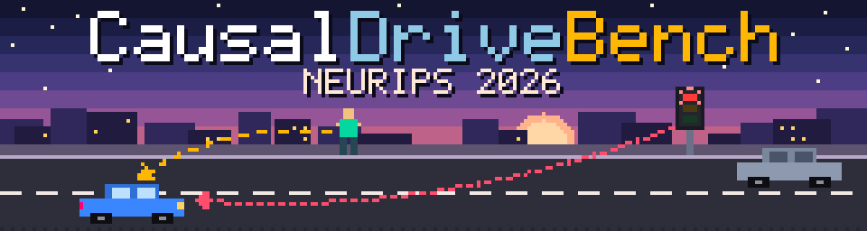
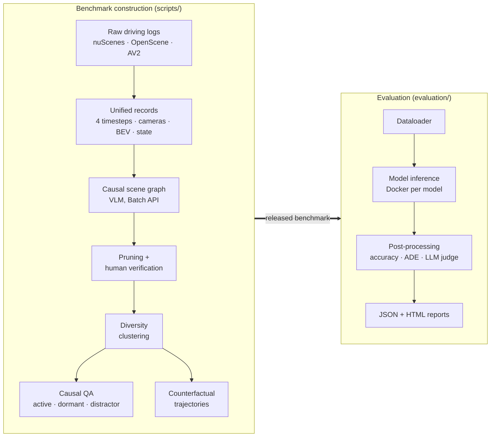

<p align="center">
  
</p>

<h1 align="center">CausalDriveBench</h1>

<p align="center">
  <b>Evaluating Causal Reasoning in Vision-Language-Action Models for Autonomous Driving</b><br>
  <i>NeurIPS 2026</i>
</p>

<p align="center">
  <a href="https://arxiv.org/abs/2609.32157"></a>
  <a href="https://huggingface.co/datasets/causaldrivebench/CausalDriveBench"></a>
  <a href="https://arxiv.org/abs/2609.32157"></a>
  <a href="LICENSE"></a>
  <a href="https://creativecommons.org/licenses/by-nc-sa/4.0/"></a>
  
</p>

<div align="center" markdown="1">

📄 [**Paper**](https://arxiv.org/abs/2609.32157) &nbsp;·&nbsp;
🤗 [**Dataset**](https://huggingface.co/datasets/causaldrivebench/CausalDriveBench) &nbsp;·&nbsp;
🗂️ [**Code & Doc Index**](INDEX.md) &nbsp;·&nbsp;
🧪 [**Evaluation Framework**](evaluation/README.md) &nbsp;·&nbsp;
📑 [**Citation**](#citation)

</div>

---

**CausalDriveBench** tests whether driving vision-language-action (VLA) models reason *causally*: can they explain **why** the ego vehicle brakes, yields or proceeds, and predict **what it would do** if the scene were different? Grounded in **Pearl's Causal Hierarchy**, it combines structured causal visual question answering with counterfactual trajectory prediction on real nuScenes driving scenes. Each scene is backed by a causal scene graph that separates *active*, *dormant* and *distractor* entities.

This repository contains the full code for **building** the benchmark (records → causal scene graphs → QA → counterfactual trajectories) and for **evaluating** VLAs / VLMs on it.

> *The banner shows the idea in miniature: the red light is an **active** cause of the ego car's behaviour (red, dotted), the pedestrian on the kerb is a **dormant** cause (amber, dashed), and the parked car is a **distractor** (no arrow).*

## Contents

- [Highlights](#highlights)
- [Benchmark overview](#benchmark-overview)
- [Dataset](#dataset)
- [Repository structure](#repository-structure)
- [Installation](#installation)
- [Quick start: evaluate a model](#quick-start-evaluate-a-model)
- [Supported models](#supported-models)
- [Results](#results)
- [Regenerating the benchmark](#regenerating-the-benchmark)
- [Data formats](#data-formats)
- [Troubleshooting](#troubleshooting)
- [Citation](#citation)
- [License](#license)
- [Acknowledgements](#acknowledgements)

---

## Highlights

- 🧭 **Pearl's Causal Hierarchy, made concrete for driving.** Questions span association, intervention and counterfactual rungs. They are generated from causal scene graphs whose edges are labelled *active-sustaining*, *active-triggering* or *dormant*, and the graphs also list *distractors*.
- 📦 **7,285 verified causal QA pairs** and **1,000 counterfactual trajectories** on nuScenes.
- 🤖 **13 models evaluated**: 10 driving-specific VLAs and 3 general-purpose VLMs.
- 📉 **Causal reasoning remains hard.** The best model reaches **70.6 %** QA accuracy, and **4 of 13** models score *below random chance*.
- 🔁 **Driving fine-tuning costs causal reasoning.** Compared with the general-purpose VLM that shares its backbone, a driving fine-tune loses **2–34 percentage points** on causal QA.
- 🔀 **Language and action are decoupled.** Causal-QA accuracy and trajectory accuracy are **statistically uncorrelated**.

> *"Neither fluent rationales nor accurate observed-scene trajectories constitute evidence of causal understanding."*

---

## Benchmark overview



**What a model is asked to do**

| Task | Source in graph | What it probes |
|---|---|---|
| **Active QA** (Causal Ladder) | Active ego edges | Association → intervention → counterfactual questions about entities that currently drive ego behaviour (rungs R0–R3). |
| **Dormant QA** | Dormant ego edges | Entities that *would* affect the ego under a small change (e.g. a pedestrian approaching the kerb). |
| **Distractor QA** | Distractor list | Recognising entities with *no* causal influence on the ego. |
| **BTE**: baseline trajectory | Observed scene | Predict the ego's future waypoints in the real scene. |
| **CTE-R2 / CTE-R3**: counterfactual trajectory | Intervened scene | Predict the ego's trajectory after an intervention (R2) or in an alternate history (R3). |

**Causal scene graph schema**: 5 node types (`TRAFFIC_CONTROL`, `ROAD_OBSTACLE`, `OTHER_AGENT`, `ENVIRONMENT`, `EGO`). 5 ego-edge effects (`CONSTRAINS_LONGITUDINAL`, `CONSTRAINS_LATERAL`, `INHIBITS_PROCEED`, `GRANTS_PROCEED`, `DEGRADES`). 2 inter-node edges (`AFFECTS`, `CONFOUNDED_BY`). 3 causal statuses (`active_sustaining`, `active_triggering`, `dormant`). A `distractors` list with rejection reasons.

---

## Dataset

The released benchmark is hosted on Hugging Face: **[causaldrivebench/CausalDriveBench](https://huggingface.co/datasets/causaldrivebench/CausalDriveBench)**.

```python
from datasets import load_dataset

qa = load_dataset("causaldrivebench/CausalDriveBench", "qa", split="test")
print(qa)          # question, options, correct_answer, reasoning, rung, category, difficulty, ...
```

Each QA row has the question, answer options, correct answer and reasoning, plus metadata: rung, category, difficulty, graph structure, counterfactual frame and spatial context. The per-sample release layout produced by [`scripts/release/package_samples.py`](scripts/release/package_samples.py) is:

```
<dataset>/<scene>/<SAMPLED_N>/
├── meta.json          # scene metadata (token, log, location, timestamp)
├── state.json         # ego + agent states at T=0 (ego-local coordinates)
├── calib.json         # camera intrinsics + extrinsics
├── frames.json        # paths to the original raw sensor images per timestep (Tm1p5 … Tp0p0)
├── graph.json         # verified causal scene graph
└── qa/
    ├── active_qa.json
    ├── dormant_qa.json
    └── distractor_qa.json
```

A small sample in this exact format ships with the repo under [`evaluation/sample_data/`](evaluation/sample_data/causal_nuscenes/manifest.json), so you can try the pipeline without downloading anything.

> **Raw imagery is not redistributed.** `frames.json` points into the original datasets, which you must obtain separately under their own terms ([nuScenes](https://www.nuscenes.org/), [OpenScene / NAVSIM](https://github.com/OpenDriveLab/OpenScene), [Argoverse 2](https://www.argoverse.org/av2.html)).

---

## Repository structure

```
causaldrivebench/
├── scripts/                  # Benchmark construction pipeline
│   ├── build_records/        #   raw logs → unified records (nuScenes, OpenScene, AV2)
│   ├── batch_processing/     #   ⭐ run_batch_pipeline.sh: graph → QA → trajectories via Batch API
│   ├── causal_graph_extraction/  # pruning, subgraph extraction & statistics
│   ├── graph_postprocessing/ #   post-review clean-up → *_verified.json
│   ├── graph_filtering/      #   diversity clustering & subset selection
│   ├── question_answers/     #   QA balancing & statistics
│   ├── counterfactual_trajectory/  # CF / agent-intervention trajectories
│   ├── rendering/            #   interactive D3 HTML viewers + review editor
│   ├── release/              #   release packaging
│   └── download/             #   dataset download helpers
├── prompts/                  # All VLM prompt templates (graph, QA, trajectories, verification)
├── evaluation/               # Containerised multi-model evaluation framework
│   ├── common/               #   base classes, metrics, trajectory eval, LLM judge, reports
│   ├── models/               #   one folder per evaluated model (+ _template)
│   ├── docs/                 #   architecture, data formats, adding a model, …
│   └── sample_data/ · sample_outputs/ · sample_reports/   # runnable examples
├── driving_rules/            # Driving-rule knowledge base (generic, Singapore, California)
├── docs/                     # Project overview & design specs
├── config.yaml.example       # Pipeline configuration template
└── environment.yaml          # Conda environment
```

👉 See **[INDEX.md](INDEX.md)** for a file-by-file index of all code and documentation.

---

## Installation

```bash
git clone https://github.com/renesas/causaldrivebench.git
cd causaldrivebench

# Benchmark-construction environment
conda env create -f environment.yaml
conda activate causal_graph

# Graph PNG rendering
sudo apt install graphviz

# Pipeline configuration (paths, provider, API keys); config.yaml is git-ignored
cp config.yaml.example config.yaml
```

Evaluation runs each model in its **own Docker container**, so you need Docker with the NVIDIA Container Toolkit for GPU models. See [evaluation/docs/docker_operations.md](evaluation/docs/docker_operations.md).

---

## Quick start: evaluate a model

### 1. Try it on bundled sample data (no GPU, no download)

```bash
# From the repo root, in any Python ≥ 3.10 env with numpy, pillow, tqdm
export PYTHONPATH="$PYTHONPATH:$(pwd)"

# Simulate a full run (dataloader → synthetic outputs → 4-tier reports)
python evaluation/generate_sample_outputs.py

# Re-run post-processing on the simulated run
python evaluation/models/alpamayo_1_0/postprocess.py \
    --run-dir   evaluation/sample_outputs/<run_dir> \
    --bench-dir evaluation/sample_data/causal_nuscenes \
    --mode single --scene nuscenes-scene-0072
```

An example of the generated static HTML report is in [`evaluation/sample_reports/`](https://github.com/renesas/causaldrivebench/tree/main/evaluation/sample_reports) (open `index.html` locally in a browser).

### 2. Evaluate a real model (Docker)

```bash
cd evaluation/models/<model>/            # e.g. alpamayo_1_5, recogdrive, orion, …

cp dev.env.example dev.env               # set data paths, HF token, GPU, …
docker compose build
docker compose --profile setup run --rm weight-downloader

# Smoke-test on one scene, then drop MODE/SCENE for the full benchmark
MODE=single SCENE=nuscenes-scene-0001 docker compose run --rm inference
MODE=single SCENE=nuscenes-scene-0001 docker compose --profile postprocess run --rm postprocess
```

Docker-based model folders have a `commands.md` cheat-sheet with their exact commands. Post-processing can also score reasoning quality with an **LLM judge**: four dimensions, 0–2 each. See [evaluation/docs/llm_judge.md](evaluation/docs/llm_judge.md).

### 3. Evaluate several models at once

```bash
python evaluation/orchestrate.py \
    --models alpamayo_1_0,alpamayo_1_5 \
    --dataset nuscenes --mode subset --subset-size 50 \
    --output-dir evaluation/outputs --report-dir evaluation/reports
```

**Adding your own model?** Copy [`evaluation/models/_template/`](evaluation/models/_template/commands.md), implement the dataloader, inference and post-processor, then follow [evaluation/docs/adding_a_model.md](evaluation/docs/adding_a_model.md).

---

## Supported models

Integrations live in [`evaluation/models/`](INDEX.md#evaluationmodels-model-integrations). Each one wraps the upstream model behind the same `dataloader → inference → postprocess` interface.

| Folder | Upstream model | Type |
|---|---|---|
| `alpamayo_1_0` | NVIDIA Alpamayo-R1-10B (reference implementation) | Driving VLA |
| `alpamayo_1_5` | NVIDIA Alpamayo-1.5-10B | Driving VLA |
| `doe` | Doe-1 | Driving world model |
| `impromptu_vla` | Impromptu-VLA 3B | Driving VLA |
| `omnidrive` | NVlabs OmniDrive | Driving VLA |
| `opendrivevla` | OpenDriveVLA-0.5B | Driving VLA |
| `orion` | ORION | Driving VLA |
| `recogdrive` | ReCogDrive-8B-RL | Driving VLA |
| `safeauto` | SafeAuto | Driving VLA |
| `simlingo` | SimLingo | Driving VLA |
| `gemma4` | Google Gemma 4 (E2B / E4B / 26B-A4B / 31B) | General VLM |
| `qwen25vl` | Qwen2.5-VL-3B / 7B-Instruct | General VLM |
| `_template` | Starting point for new integrations | – |

---

## Results

The official results tables (per-rung and per-QA-type accuracy, BTE / CTE trajectory ADE) are in the [paper](https://arxiv.org/abs/2609.32157). In short:

- The best model reaches **70.6 %** causal-QA accuracy. **4 of 13** models fall below random chance.
- Driving-specific fine-tuning **reduces** causal-QA accuracy by **2–34 pp** relative to the matching general-purpose backbone.
- Causal-QA accuracy and trajectory accuracy are **statistically uncorrelated**: a model can plan well in the observed scene without understanding why.

To reproduce, run the evaluation framework above on the Hugging Face release. [`evaluation/sanity_check.py`](evaluation/sanity_check.py) verifies run completeness, and [`evaluation/scripts/reorganize_and_report.py`](evaluation/scripts/reorganize_and_report.py) builds Markdown / LaTeX tables.

---

## Regenerating the benchmark

The released dataset is all you need for evaluation. The sections below are for **rebuilding or extending** the benchmark from raw driving logs. Click a section to expand it.

```
Raw data → Records → Stage 1: causal graph → Pruning → Stage 3a/3b/3c: QA → Stage 4cf / 5: counterfactual trajectories → HTML / release
```

<details markdown="1">
<summary><b>1. Data acquisition</b></summary>

- **nuScenes**: download from <https://www.nuscenes.org/>: the full dataset (v1.0-trainval: metadata + camera images) and the **map expansion pack**.
- **OpenScene (NAVSIM)**: use the helper scripts:
  ```bash
  bash scripts/download/download_openscene_metadata.sh <LOGS_DIR>
  bash scripts/download/download_openscene_sensor.sh
  bash scripts/download/download_nuplan_maps.sh
  ```
- **Argoverse 2**: download the *sensor* split (train and/or val) from <https://www.argoverse.org/av2.html>.

</details>

<details markdown="1">
<summary><b>2. Record building</b></summary>

Record building converts each raw dataset into one **unified record format** that every downstream step consumes:

```
<RECORDS>/<scene_name>/SAMPLED_N/
├── meta.json
├── Tm1p5/  Tm1p0/  Tm0p5/        # T = -1.5 s, -1.0 s, -0.5 s: bev.png + cameras
└── Tp0p0/                        # T = 0 (present)
    ├── bev.png                   # 1536×1536 BEV with heading arrows
    ├── cam_front.jpg …           # cameras annotated with 2D boxes + labels
    ├── state.json                # ego + agent states (ego-local coordinates)
    ├── calib.json                # camera intrinsics + extrinsics
    └── uuid_map.json             # short labels (car_1) → dataset UUIDs
```

The record builders apply these rules:

- **Temporal BEVs:** 4 frames, all in the T=0 ego frame.
- **Agent radius:** 30 m for vehicles, 25 m for pedestrians.
- **Visibility filter** (nuScenes): vehicles at least 40 % visible, pedestrians at least 60 %.
- **Occlusion filter:** multi-ray 3D raycast.
- **Argoverse 2:** uses 5 cameras.
- **Large images:** anything over 2000 px is resized when batches are prepared.

```bash
conda activate causal_graph

# nuScenes
python scripts/build_records/build_nuscenes_records.py \
  --data /path/to/nuscenes --maps /path/to/maps/expansion \
  --records /path/to/records/nuscenes --num-scenes 120

# OpenScene (quartile sampling, 4 samples per scene)
python scripts/build_records/build_openscene_records.py \
  --logs /path/to/navsim_logs --blobs /path/to/openscene --maps /path/to/openscene/maps \
  --records /path/to/records/openscene --num-scenes 100 --max-samples 4

# Argoverse 2 (5 cameras); --split train | val | both
python scripts/build_records/build_argoverse2_records.py \
  --data /path/to/argoverse2/sensor --split val \
  --records /path/to/records/argoverse2 --num-scenes 133
```

The builders skip existing scenes unless you pass `--force`. Other useful flags:

- `--scenes …`: build specific scenes only.
- `--samples-file`: build specific `scene/SAMPLED_N` pairs.
- `--workers N`: number of parallel workers (default 4).

</details>

<details markdown="1">
<summary><b>3. Batch pipeline (graphs → QA → trajectories)</b></summary>

[`scripts/batch_processing/run_batch_pipeline.sh`](scripts/batch_processing/run_batch_pipeline.sh) drives every generation stage through a provider's Batch API (Claude by default).

| Stage | Name | Description |
|---|---|---|
| **1** | Generator | Images + `state.json` → raw causal scene graph |
| **prune** | Pruning | Reverse-BFS reachability; nodes with no causal path to ego → distractors |
| **3a** | Causal Ladder QA | Active edges → `active_qa.json` |
| **3b** | Dormant QA | Dormant edges → `dormant_qa.json` |
| **3c** | Distractor QA | Distractors → `distractor_qa.json` |
| **4cf** | CF trajectories | QA items with `trajectory_changes=true` → routed (below) |
| **5** | LLM ego trajectory | Agent interventions (remove / reposition / speed change) → LLM-predicted ego response (`--nuplan` uses the nuPlan simulator instead, stage 4np) |

Stage 4cf routing:

| Route | Condition | Prompts | Output |
|---|---|---|---|
| `nuplan_config` | `entity_type=agent` | `prompts/nuplan_config/` | Agent intervention config → consumed by stage 5 / 4np |
| `llm_t0` | infrastructure, anchor `t0` | `prompts/alternate_trajectories/Intervention_*` | 8 future ego waypoints |
| `llm_obs_window` | infrastructure, anchor `observation_window` | `prompts/alternate_trajectories/CounterFactual_*` | 4 alternate-history ego waypoints |

```bash
# Full pipeline for one dataset (nuscenes | openscene | argoverse2)
bash scripts/batch_processing/run_batch_pipeline.sh nuscenes \
  --provider claude \
  --records-dir /path/to/records/nuscenes \
  --output-dir  /path/to/outputs/nuscenes \
  --batch-dir   /path/to/batch_jobs

# Stop early / resume
bash scripts/batch_processing/run_batch_pipeline.sh nuscenes ... --stop-after 1     # graphs only
bash scripts/batch_processing/run_batch_pipeline.sh nuscenes ... --stop-after 3c    # through QA
bash scripts/batch_processing/run_batch_pipeline.sh nuscenes ... --resume 3a        # graphs already exist
```

| Flag | Description |
|---|---|
| `--provider` | `claude` (default), `openai`, `gemini` |
| `--model`, `--reasoning` | Override model; reasoning effort `none` (default, recommended) / `low` / `medium` / `high` |
| `--records-dir`, `--output-dir`, `--batch-dir` | Override paths from `config.yaml` (**use a fresh `--batch-dir` per run**) |
| `--stop-after <stage>`, `--resume <stage>` | Run a sub-range of stages (`1`, `prune`, `3a`–`3c`, `4cf`, `5`) |
| `--graph-prompt-version`, `--qa-prompt-version` | Prompt versions (default `v5`) |
| `--nuplan` | Use the nuPlan simulator for agent interventions (stage 4np) instead of the LLM (stage 5) |
| `--max-samples N`, `--filter`, `--dry-run`, `--skip-download` | Limit / filter samples, preview batches, reuse downloaded results |

**Prompt versions:**

- `prompts/causal_scene_graph/v5` and `prompts/causal_qas/v5` are the defaults. `v6` is the newest graph schema and is opt-in.
- `v1`–`v4` are kept for reference.
- All datasets share the same templates. The Argoverse 2 differences (camera count, names, image order) are injected at load time.

</details>

<details markdown="1">
<summary><b>4. Graph pruning</b></summary>

After stage 1, [`prune_graphs.py`](scripts/causal_graph_extraction/prune_graphs.py) reverses every edge (`CONFOUNDED_BY` becomes bidirectional) and runs a BFS from the ego. Any node it does not reach has no causal influence on the ego and moves to `distractors`. This takes O(V + E) per graph, parallelised across files. It runs automatically in the batch pipeline, or standalone:

```bash
python scripts/causal_graph_extraction/prune_graphs.py /path/to/outputs/nuscenes --dry-run   # preview
python scripts/causal_graph_extraction/prune_graphs.py /path/to/outputs/nuscenes --workers 8 # writes *_pruned.json
```

</details>

<details markdown="1">
<summary><b>5. Graph post-processing (after human review)</b></summary>

The scripts in [`scripts/graph_postprocessing/`](INDEX.md#scriptsgraph_postprocessing-post-review-clean-up--canonical-_verifiedjson) turn human-reviewed graphs into the canonical `{scene_id}_verified.json`, which downstream QA, trajectory and release steps consume.

```bash
# 1. Work on a copy; never modify the originals
cp -r outputs/nuscenes_full_edit/ outputs/nuscenes_full_edit_backup/

# 2. Rule-based edge / node clean-up (remove --dry-run to apply)
python scripts/graph_postprocessing/fix_causal_graphs.py \
  --input-dir outputs/nuscenes_full_edit_backup/ --edits-dir edits/ --dry-run

# 3. Align scene descriptions with the remaining active edges
#    test: real-time on a few scenes, writes side-by-side comparisons
python scripts/graph_postprocessing/align_scene_description.py test \
  --input-dir outputs/nuscenes_full_edit_backup/ --edits-dir edits/ \
  --records-dir records/nuscenes_full/ --out-dir /path/to/comparison_output/
#    run: submit batch, poll, and apply → writes {scene_id}_verified.json
python scripts/graph_postprocessing/align_scene_description.py run \
  --input-dir outputs/nuscenes_full_edit_backup/ --edits-dir edits/ \
  --records-dir records/nuscenes_full/
```

Graph review itself happens in the Flask editor [`scripts/rendering/editor_server.py`](scripts/rendering/README.md).

</details>

<details markdown="1">
<summary><b>6. HTML visualisation</b></summary>

[`render_causal_graph.py`](scripts/rendering/render_causal_graph.py) renders an interactive page per sample: a D3 causal graph, the camera images, the BEV and QA cards. Each page has an *Original / Pruned* toggle and a JSON viewer.

```bash
# Paths are read from config.yaml for the given dataset
python scripts/rendering/render_causal_graph.py --dataset nuscenes \
  --html --index --root-index --serve 9888

# Non-canonical output folder
python scripts/rendering/render_causal_graph.py --dataset nuscenes \
  --output-dir /path/to/outputs/nuscenes_50 --records-dir /path/to/records/nuscenes_50 \
  --html --index --force

# Counterfactual BEV / camera overlays
python scripts/rendering/regenerate_cf_bevs.py \
  --outputs /path/to/outputs/nuscenes --records /path/to/records/nuscenes
```

The server serves from the parent of the outputs directory, so the relative image paths into `records/` resolve.

</details>

<details markdown="1">
<summary><b>7. Release packaging</b></summary>

```bash
python scripts/release/package_samples.py --dataset nuscenes      # nuscenes | openscene | argoverse2
#   --records / --outputs / --download   override paths from config.yaml
```

This assembles the [release layout](#dataset) and writes a root `manifest.json` that flags any samples with missing graph or QA files. `frames.json` lists the **original raw sensor image** paths, relative to `data_root`, not the annotated copies in the records.

</details>

---

## Data formats

<details markdown="1">
<summary><b><code>state.json</code></b>: ego + agent states</summary>

```json
{
  "t_rel_s": 0.0,
  "nav_command": "GO STRAIGHT",
  "ego": {
    "speed": 4.058,
    "history": [{"t": -1.5, "x": -6.82, "y": -0.27, "speed": 4.53}],
    "future":  [{"t": 0.5,  "x": 2.07,  "y": -0.03, "speed": 4.14}]
  },
  "agents": {
    "car_1": {
      "category": "vehicle.car",
      "position": {"x": 12.5, "y": -11.3, "yaw": 1.65},
      "speed": 0.0,
      "history": [{"t": -1.5, "x": 12.66, "y": -11.33, "speed": 0.11}]
    }
  }
}
```

Coordinates are ego-local at T=0: `+x` is forward, `+y` is left, and the ego is at the origin. History has 3 steps (t = −1.5, −1.0, −0.5 s). Future has 6 steps (t = 0.5 … 3.0 s).

</details>

<details markdown="1">
<summary><b>Causal scene graph</b> (<code>graph.json</code>)</summary>

```json
{
  "scene_id": "...",
  "scene_context": {"road_geometry": "...", "navigation_intent": "..."},
  "ego_state": {"speed_mps": "4.0", "inferred_acceleration": "...", "behavior_explanation": "..."},
  "nodes": [
    {"id": "ego", "type": "EGO"},
    {"id": "n1", "type": "TRAFFIC_CONTROL", "label": "Green signal"}
  ],
  "ego_edges": [
    {"source": "n1", "target": "ego", "effect_type": "GRANTS_PROCEED",
     "active": true, "causal_status": "active_sustaining", "justification": "..."}
  ],
  "inter_node_edges": [],
  "distractors": [{"id": "car_2", "rejection_reason": "..."}]
}
```

The full schema is in the stage-1 prompt, [`prompts/causal_scene_graph/v5/system_prompt.md`](https://github.com/renesas/causaldrivebench/blob/main/prompts/causal_scene_graph/v5/system_prompt.md). Evaluation-side formats (`prompts.jsonl`, `outputs.jsonl`, reports) are documented in [evaluation/docs/data_formats.md](evaluation/docs/data_formats.md).

</details>

---

## Troubleshooting

<details markdown="1">
<summary>Common issues</summary>

| Problem | Cause | Solution |
|---|---|---|
| Truncated JSON (`max_tokens` hit) | Response too long | `max_tokens` is set in `scripts/common/llm_provider.py` |
| Image dimensions exceed 2000 px | AV2 cameras are 2048×1550 | Images are auto-resized at batch preparation (`scene_utils.py`) |
| Old batch results reprocessed | Re-used batch directory | Use a fresh / empty `--batch-dir` for every run |
| No Causal Ladder (active) questions | All ego edges dormant | Check graph quality; active QA needs active edges |
| No dormant questions | All ego edges active | Expected: dormant QA needs dormant edges |
| `_pruned.json` not found by QA stages | Pruning not run | `python scripts/causal_graph_extraction/prune_graphs.py <output_dir>` |
| Empty BEV (no lanes / roads) | `--maps` not provided | Rebuild records with the map path |
| Missing heading arrows in temporal BEVs | Stale records | Rebuild records |
| OpenScene IDs rejected by the batch API | Dots in `custom_id` | Handled automatically (dots → `-`) |
| Docker / GPU / evaluation issues | – | See [evaluation/docs/docker_operations.md](evaluation/docs/docker_operations.md) |

</details>

---

## Citation

If you find CausalDriveBench useful, please cite:

```bibtex
@article{chembu2026causaldrivebench,
  title   = {CausalDriveBench: Evaluating Causal Reasoning in Vision-Language-Action Models for Autonomous Driving},
  author  = {Chembu, Narendiran and Rao, Navvrat and Kodate, Shreedhar Shreeshail and Banda, Gayatri Srujana and Sarkar, Arko and Khanna, Abhinav and Das, Rajarshee and Kanala, Umesh and Khandelwal, Siddarth and Aman, Kumar and Dubey, Aish and Beedkar, Kaustubh and Jain, Arjun},
  journal = {arXiv preprint arXiv:2609.32157},
  year    = {2026},
  doi     = {10.48550/arXiv.2609.32157},
  url     = {https://arxiv.org/abs/2609.32157}
}
```

---

## License

- **Code**: [BSD 3-Clause](LICENSE), © 2026 Renesas Electronics.
- **Dataset** (annotations, graphs, QA, trajectories on Hugging Face): [CC BY-NC-SA 4.0](https://creativecommons.org/licenses/by-nc-sa/4.0/).
- **Underlying sensor data** (nuScenes, OpenScene / NAVSIM / nuPlan, Argoverse 2) remains under each dataset's own license and terms of use.

## Acknowledgements

CausalDriveBench builds on [nuScenes](https://www.nuscenes.org/), [OpenScene / NAVSIM](https://github.com/OpenDriveLab/OpenScene), [nuPlan](https://www.nuscenes.org/nuplan) and [Argoverse 2](https://www.argoverse.org/av2.html). We thank the authors of all the evaluated models for releasing their code and weights.
