# CausalDriveBench — Project Overview

This document provides a non-technical summary of CausalDriveBench: what it is, what has been built so far, and what comes next.

---

## What Is CausalDriveBench?

CausalDriveBench is a benchmark for testing whether AI models that control autonomous vehicles can reason *causally* — that is, can they correctly identify *why* a car brakes, turns, or yields, not just *that* it does? The benchmark presents models with real driving recordings, asks them causal questions about what's happening, and scores their answers.

The project has two parallel workstreams:

1. **Dataset creation** — building the questions and ground-truth answers from real driving data
2. **Model evaluation** — running AI models against those questions and measuring their performance

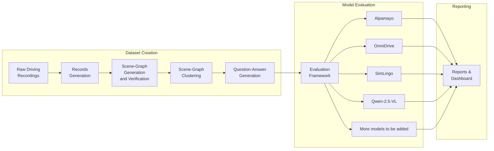

---

## Part 1 — Data Generation Progress

### CausalDriveBench-NuScenes

The primary dataset being worked on is built from **nuScenes**, a widely-used autonomous driving dataset with 1,000 driving clips recorded across Boston and Singapore. The benchmark targets a curated subset of **850 scenes** (driving clips) and **3300+ samples** from those scenes. Each scene yields a small number of carefully annotated samples that is used for scene-graph and Causal QA generation.

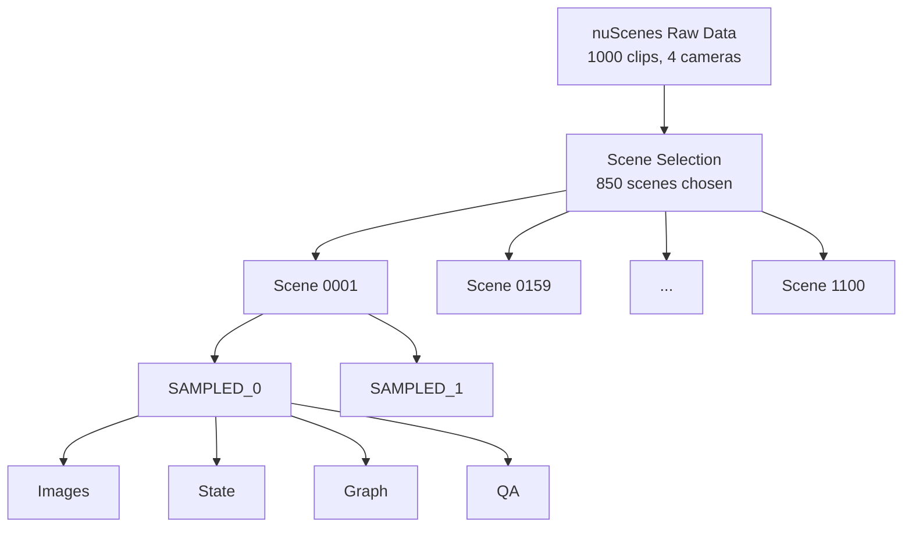

**Current status:** Records and scene graphs have been generated for a all of the scenes. Large-scale QA generation is pending final scene-graph verification and clustering (see Next Steps).

---

### Records Generation

A **record** is the atomic unit of data — a snapshot of a driving scene at a specific moment in time, enriched with sensor images, vehicle positions, and map context. Generating records is the first step of the pipeline.

**What goes into a record:**

- **Camera images** — four camera views (front, front-left, front-right, rear) captured at four moments in time (−1.5 s, −1.0 s, −0.5 s, and now (0 s))
- **Bird's-eye view (BEV)** — a top-down map rendering that shows annotations for the ego vehicle, nearby agents, lane markings, and traffic controls
- **State data** — exact positions and speeds of every visible vehicle, pedestrian, and cyclist in the scene, expressed in the ego vehicle's local coordinate system
- **Calibration data** — how each camera is oriented so that the 2-D images can be related to the 3-D world

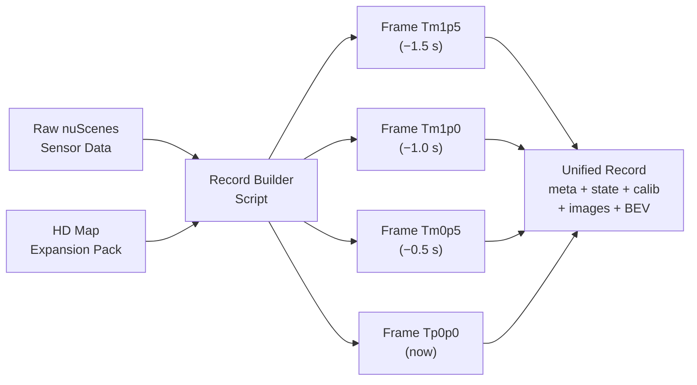

**Quality controls applied during record generation:**

TODO -- REVIEW and EDIT THE FOLLOWING

- Vehicles must be at least 40% visible; pedestrians at least 60% — partially-occluded agents are excluded
- A nine-ray 3-D occlusion test confirms that each agent truly has a clear line of sight to the ego vehicle
- Images larger than 2,000 pixels are automatically down-sampled to stay within API limits

**Current status:** Record generation is complete for the nuScenes subset.

---

### Scene-Graph Generation and Verification

With records in hand, the next step is to use a large vision language models (e.g. Claude Opus) to read the sensor images, BEV, state metadata and produce a **causal scene graph** — a structured diagram of which entities in the scene are affecting the ego vehicle's driving, and how.

**What a scene graph contains:**

| Element | Description | Example |
|---|---|---|
| **Nodes** | Entities present in the scene | Red traffic light, pedestrian, wet road |
| **Ego edges** | How each entity directly influences the ego | "Red light → inhibits proceeding" |
| **Inter-node edges** | Relationships between non-ego entities | "Pedestrian → confounded by same red light as car_1" |
| **Distractors** | Entities present but causally irrelevant | Parked car two blocks away |

**Node types recognised:**

TODO -- REVIEW and EDIT THE FOLLOWING

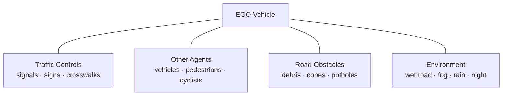

**Influence types (example ego edges):**

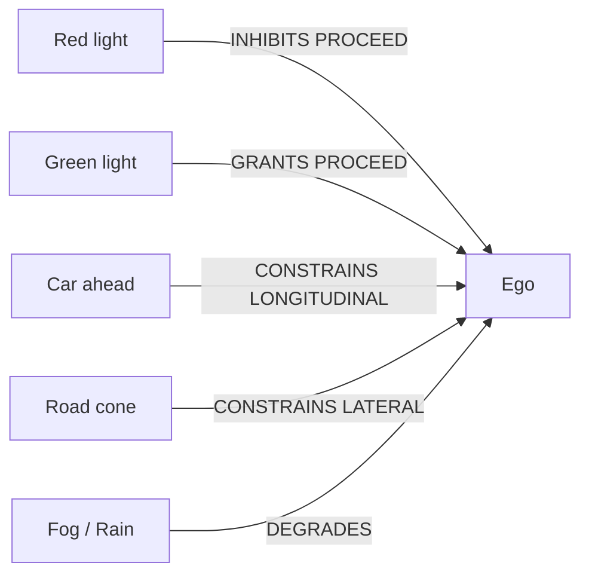

**Causal status of each edge:**

- **Active-sustaining** — remove this entity *right now* and the ego's immediate next action changes (e.g., traffic light turns green → car moves)
- **Active-triggering** — this entity *started* the current maneuver but removing it now wouldn't immediately change the trajectory (e.g., the red light that caused the ego to begin braking 1.5 s ago)
- **Dormant** — not affecting the ego currently, but a small change to this entity's state *would* create an effect (e.g., a pedestrian approaching the curb)

**Verification:** After a large VLM generates raw graphs, an automated pruning script removes any distractor nodes (entities with no causal path to the ego) using a graph-reachability algorithm. The resulting *pruned graph* is what the benchmark uses.

**Current status:** Scene-graph generation and automated pruning are complete. A third-time manual verification of graph quality is ongoing before large-scale QA generation begins.

TODO -- REVIEW and EDIT THE FOLLOWING

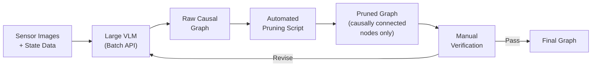

---

### Graph Clustering and Cataloging

Once scene graphs are verified, they are **clustered** into groups based on their topological patterns — for example, "scenes where a traffic light is the primary cause" vs "scenes with a pedestrian crossing as the primary cause." Cataloging ensures the benchmark covers a diverse range of causal scenarios.

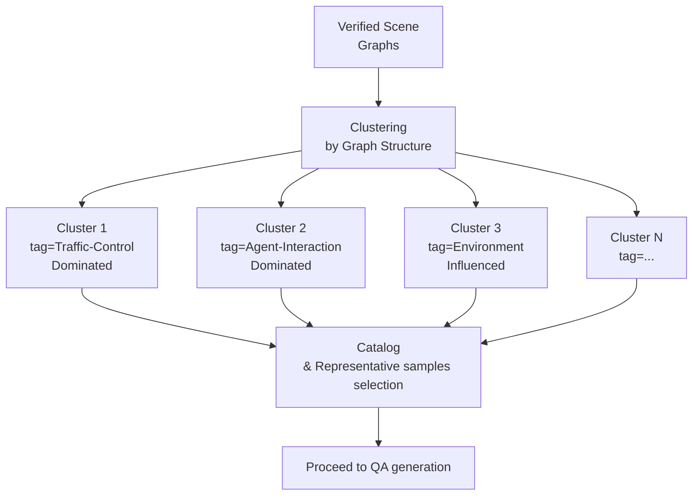

**Current status:** Clustering methodology is being refined and the scene-graphs are being edited manually for tail-end graph clusters to ensure high-quality clustering. A final clustering will follow to generate representative graph samples that will be used for high-quality QA generation.

---

### Question-Answer Generation and Verification

With verified, clustered graphs in place, a large VLM generates **multiple-choice and binary type of questions** that probe three distinct aspects of causal reasoning:

| Question Type | What It Tests | Example |
|---|---|---|
| **Causal Ladder** | Active causal relationships (12 sub-types: counterfactual inference, attribution, etc.) | "If the red light had been green, would the ego vehicle have stopped?" |
| **Dormant** | Recognising entities that *could* affect driving but currently don't | "Would the cyclist affect the ego if they moved into the lane?" |
| **Distractor** | Identifying entities that have *no* causal influence | "Is the parked truck three blocks away affecting the ego's speed?" |

TODO -- REVIEW and EDIT THE FOLLOWING

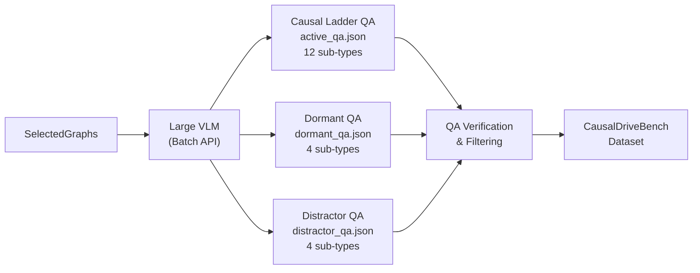

**Question verification** checks that:
- Questions are answerable from the images and graph alone
- Ground-truth answers are unambiguous
- Questions are linguistically clear

**Current status:** QA generation pipeline is ready by incorporating manual verification feedback and tested on the sample subset. Large-scale QA generation is gated on final graph verification, clustering and selection.

---

## Part 2 — Model Benchmarking Progress

### Framework

The evaluation framework is a **modular and containerized pipeline** that takes the benchmark dataset as input, runs an AI model against every question, and produces structured accuracy reports. It is designed so that adding a new model requires implementing only three focused components — everything else (file management, batching, resumption, reporting) is shared.

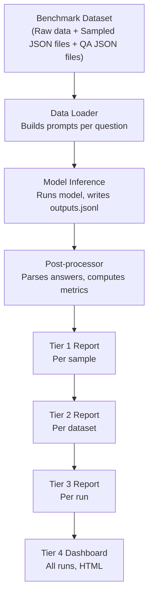

**Key design properties:**

- **Resumable** — if a run is interrupted, it picks up where it left off
- **Isolated** — each model runs in its own Docker container with its own dependencies
- **Uniform** — all models receive inputs and produce outputs in the exact same format
- **Extensible** — adding a new model is a 12-step process with a template to start from

**Optional LLM Judge:** Beyond checking if the answer letter is correct, the framework can optionally run a separate Claude judge to score the *quality of the model's reasoning* on four dimensions (spatial grounding, mechanism identification, conditionality awareness, answer consistency), each scored 0–2.

TODO -- REVIEW and EDIT THE FOLLOWING

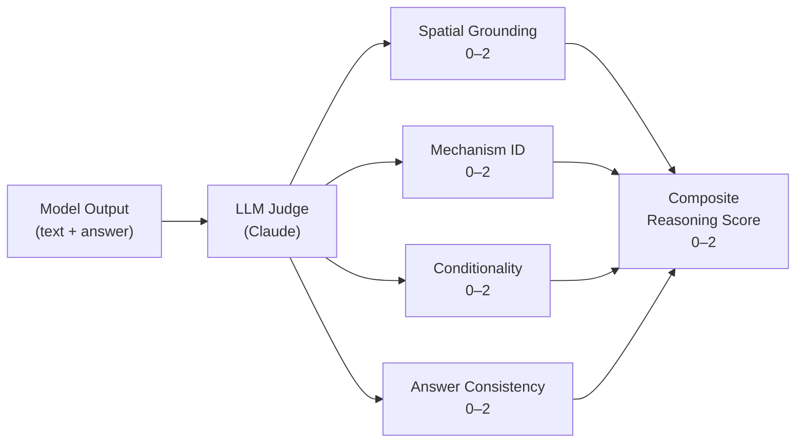

---

### Models

#### Alpamayo (1.0 and 1.5)

Alpamayo is an NVIDIA PhysicalAI vision-language model built on the Qwen3-VL architecture. It takes multi-camera images, and the ego vehicle's trajectory history as input, and produces a chain-of-causation reasoning text followed by a trajectory prediction.

**Status:** Fully integrated, Docker workflow complete, sample runs executed. Both version 1.0 and version 1.5 are enabled in the evaluation registry.

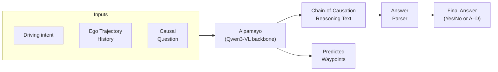

---

#### OmniDrive

OmniDrive is a vision-language model designed for end-to-end autonomous driving with structured scene understanding. It processes multi-view images and produces language-grounded predictions.

**Status:** Directory scaffolded, evaluation integration code to be implemented.

---

#### SimLingo

SimLingo is a simulation-aware driving model that combines language understanding with trajectory simulation. It is particularly suited for counterfactual and causal reasoning tasks.

**Status:** Directory scaffolded, evaluation integration code to be implemented.

---

#### Qwen-2.5-VL

Qwen-2.5-VL is a general-purpose multimodal large language model from Alibaba with strong visual grounding capabilities. Its broad visual understanding makes it a useful baseline for comparison against driving-specialist models.

**Status:** Evaluation integration code to be implemented.

---

**Model registry summary:**

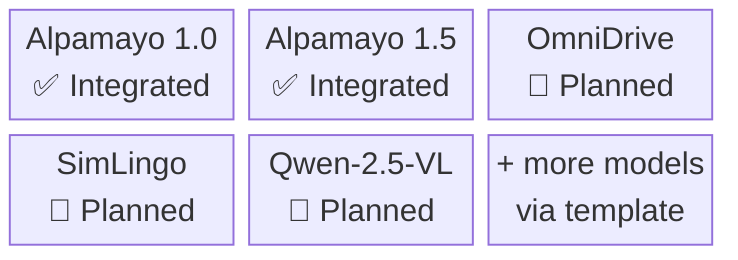

---

## Part 3 — Report Structure

Reports are generated in four tiers, aggregating from the finest granularity (individual questions) up to a global dashboard across all models and runs.

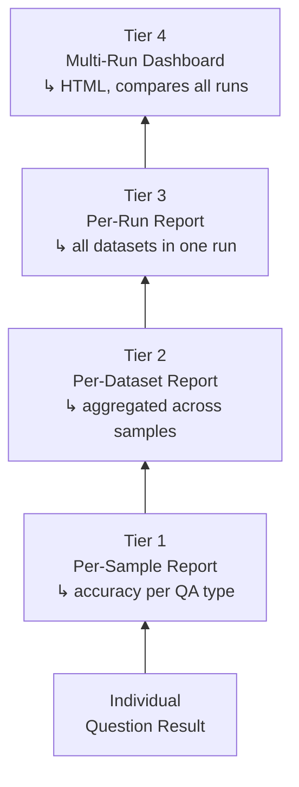

**Metrics captured at each tier:**

| Metric | Description |
|---|---|
| Overall accuracy | % of questions answered correctly across all types |
| Per-QA-type accuracy | Accuracy broken down by Ladder / Dormant / Distractor |
| Per-question-type accuracy | Accuracy per sub-type (e.g., counterfactual inference, attribution) |
| Reasoning score *(optional)* | LLM judge composite score (0–2) and per-dimension breakdown |

**Report format:** JSON files for programmatic access + an HTML dashboard for visual inspection.

---

## Next Steps

1. **Large-scale QA generation** — Once scene-graph verification and clustering are finalised, generate questions and answers at scale across all the selected nuScenes scenes and samples.

2. **Additional model evaluation code** — Implement the evaluation integration for OmniDrive, SimLingo, Qwen-2.5-VL and more models following the existing template and Alpamayo as reference.

3. **Improve reports and analysis** — Enhance the HTML dashboard and per-run reports with richer visualisations (e.g., per-graph-structure breakdowns, confidence calibration plots).

4. **Update results in paper** — Run the full benchmark across all enabled models and update quantitative tables and figures in the NeurIPS paper draft.

---

## Additional Notes and References

TODO -- REVIEW and EDIT THE FOLLOWING

This section points to the specific files, scripts, and prompts where each part of the overview is implemented.

### Data Generation — Code and Prompts

| Topic | File / Path | Notes |
|---|---|---|
| Record building (nuScenes) | `scripts/build_records/build_nuscenes_records.py` | Converts raw sensor data → unified records |
| Record building (Argoverse2) | `scripts/build_records/build_argoverse2_records.py` | 5-camera variant |
| Record building (OpenScene) | `scripts/build_records/build_openscene_records.py` | NAVSIM log format |
| Batch pipeline orchestrator | `scripts/batch_processing/run_batch_pipeline.sh` | Master script for Stages 1–5 |
| Batch preparation | `scripts/batch_processing/prepare_batches.py` | Builds Claude Batch API JSONL files |
| Batch submission & monitoring | `scripts/batch_processing/submit_batch.py`, `monitor_batches.py` | Tracks API batch jobs |
| Graph pruning algorithm | `scripts/causal_graph_extraction/prune_graphs.py` | Reverse-BFS reachability; removes distractors |
| Graph verification | `scripts/batch_processing/verify_graphs.py` | Quality checks on generated graphs |
| HTML graph visualiser | `scripts/rendering/render_causal_graph.py` | Interactive D3.js viewer with image panels |
| Release packager | `scripts/release/package_samples.py` | Assembles final downloadable dataset structure |

### Prompts Used by Claude

| Prompt | Path | Stage Used |
|---|---|---|
| Causal scene graph extraction | `prompts/causal_scene_graph/v5/` | Stage 1 — graph generation |
| Causal Ladder QA generation | `prompts/causal_qas/v5/` (ladder) | Stage 3a — active edge questions |
| Dormant Nodes QA generation | `prompts/causal_qas/v5/` (dormant) | Stage 3b — dormant edge questions |
| Distractor Nodes QA generation | `prompts/causal_qas/v5/` (distractor) | Stage 3c — distractor node questions |
| Counterfactual trajectory (T0) | `prompts/alternate_trajectories/` | Stage 4cf — LLM-predicted ego response |
| Agent intervention ego response | `prompts/agent_intervention/` | Stage 5 — ego response to agent changes |
| LLM judge system prompt | `evaluation/common/prompts/llm_judge_system.txt` | Scoring rubric for reasoning quality |
| LLM judge user template | `evaluation/common/prompts/llm_judge_user_template.txt` | Per-question scoring input |

### Evaluation Framework — Code

| Component | File / Path | Notes |
|---|---|---|
| Dataset loader | `evaluation/common/dataset.py` | Loads records and QA files |
| Abstract data loader | `evaluation/common/base_dataloader.py` | Base class all models implement |
| Abstract inference | `evaluation/common/base_inference.py` | Base class; handles batching and resumption |
| Abstract post-processor | `evaluation/common/base_postprocess.py` | Base class; handles metrics and reports |
| Metrics utilities | `evaluation/common/metrics.py` | Accuracy, confusion matrix |
| LLM judge | `evaluation/common/llm_judge.py` | 4-dimension reasoning scorer |
| HTML reporter | `evaluation/common/html_reporter.py` | Report → HTML generation |
| Multi-model orchestrator | `evaluation/orchestrate.py` | Top-level CLI entry point |
| Sample output generator | `evaluation/generate_sample_outputs.py` | Offline demo (no GPU needed) |
| Global configuration | `evaluation/eval_config.yaml` | All paths, model registry, QA types, judge config |

### Model Implementations

| Model | Key Files | Status |
|---|---|---|
| Alpamayo 1.0 | `evaluation/models/alpamayo_1_0/dataloader.py`, `inference.py`, `postprocess.py`, `docker-compose.yml` | ✅ Complete |
| Alpamayo 1.5 | `evaluation/models/alpamayo_1_5/` (same structure) | ✅ Complete |
| OmniDrive | `evaluation/models/omnidrive/` (scaffolded) | 🔧 Integration pending |
| SimLingo | `evaluation/models/simlingo/` (scaffolded) | 🔧 Integration pending |
| Qwen-2.5-VL | *(to be added)* | 🔧 Not yet started |
| New model template | `evaluation/models/_template/` | Canonical starting point |

### Documentation

| Document | Path | Contents |
|---|---|---|
| Framework architecture | `evaluation/docs/architecture.md` | Class hierarchy, design decisions |
| Evaluation pipeline | `evaluation/docs/evaluation_pipeline.md` | End-to-end flow with diagrams |
| Data formats | `evaluation/docs/data_formats.md` | JSONL schemas, directory layouts |
| Adding a model | `evaluation/docs/adding_a_model.md` | 12-step integration guide |
| Docker operations | `evaluation/docs/docker_operations.md` | Container management |
| LLM judge | `evaluation/docs/llm_judge.md` | Scoring rubric and configuration |
| Agent trajectory spec | `docs/agent_trajectory_intervention_spec.md` | Counterfactual trajectory design |

### Sample Data for Development

| Resource | Path | Purpose |
|---|---|---|
| Sample benchmark data | `evaluation/sample_data/causal_nuscenes/` | Two NuScenes samples; no GPU or dataset access needed |
| Sample inference outputs | `evaluation/sample_outputs/` | Example outputs.jsonl and prompts.jsonl |
| Sample reports | `evaluation/sample_reports/` | Example Tier 1–3 report JSON files |
| Unit tests | `evaluation/tests/` | Framework tests (run with `pytest tests/ -v`) |
| Model-specific tests | `evaluation/models/alpamayo_1_0/tests/` | Alpamayo-specific unit tests |
