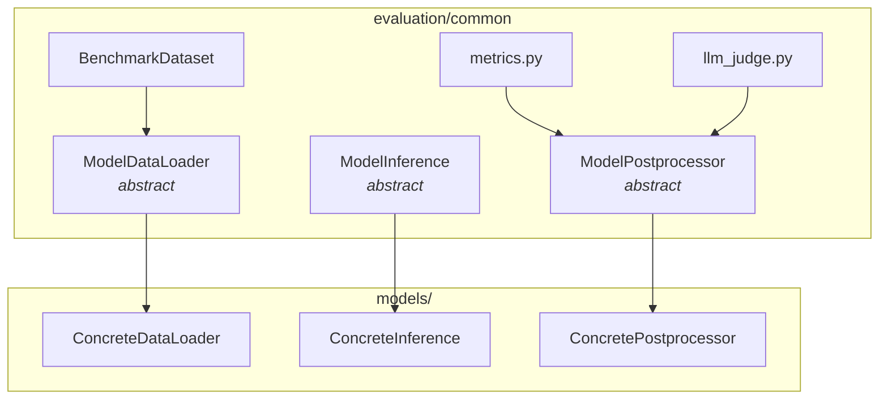
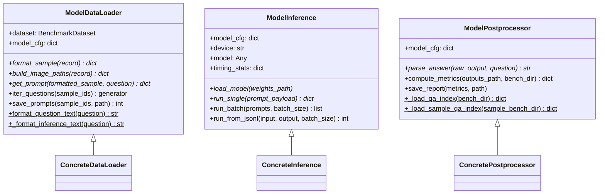
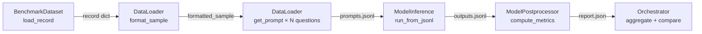

# Framework Architecture

This document describes the design of the containerized multi-model CausalDriveBench evaluation framework.

---

## Design Principles

1. **Separation of concerns** — dataset loading, inference, and post-processing are independently executable stages, each reading/writing JSONL files.
2. **Resumability** — every stage checks what has already been written and skips completed work.
3. **Model isolation** — each model runs in its own Docker container with pinned dependencies, preventing cross-contamination.
4. **Factory pattern** — abstract base classes define the interface; each model subclasses only what differs.
5. **Per-sample output structure** — outputs mirror the benchmark directory layout, making partial runs and per-scene inspection straightforward.

---

## Repository Layout

```
evaluation/
├── README.md                  # Entry point and quick-start
├── eval_config.yaml           # Dataset paths + model registry
├── orchestrate.py             # Top-level CLI (build → infer → postprocess)
├── docker_steps.md            # Legacy quickstart (superseded by docs/)
├── docs/                      # Design documentation (this folder)
├── common/                    # Shared framework code
│   ├── dataset.py             # BenchmarkDataset — record + QA loader
│   ├── base_dataloader.py     # Abstract ModelDataLoader
│   ├── base_inference.py      # Abstract ModelInference
│   ├── base_postprocess.py    # Abstract ModelPostprocessor
│   ├── metrics.py             # Pure-Python accuracy / confusion utilities
│   ├── llm_judge.py           # LLM-based open-ended scoring
│   └── utils/
│       ├── errors.py          # Non-recoverable errors (EvaluationError hierarchy)
│       ├── exceptions.py      # Recoverable exceptions (EvaluationException hierarchy)
│       └── debugging_tools.py # inspect_object helper
└── models/
    ├── _template/             # Canonical starting point for new models
    └── <model_name>/          # Concrete implementations
```

---

## Component Diagram



---

## Base Class Hierarchy



Abstract methods (marked `*`) are the only ones each model **must** implement.

---

## Data Flow



Each arrow represents a JSONL file written to disk, enabling independent execution and resumption of any stage.

---

## Error Handling

Two parallel hierarchies keep recoverable failures separate from fatal ones:

| Hierarchy | Base | Examples | Behavior |
|-----------|------|---------|----------|
| `EvaluationError` | Non-recoverable | `TensorShapeError`, `MissingEnvVarError` | Raises and halts |
| `EvaluationException` | Recoverable | `EmptyResponseException`, `MissingFrameException` | Caught, logged, skipped |

The base inference class catches `EvaluationException` per prompt and continues; `EvaluationError` propagates.

---

## Output Directory Structure

Each model writes outputs in a per-sample subfolder structure that mirrors the benchmark layout:

```
outputs/
└── causal_nuscenes/
    ├── nuscenes-scene-0001/
    │   ├── SAMPLED_0/
    │   │   ├── prompts.jsonl
    │   │   └── outputs.jsonl
    │   └── SAMPLED_1/
    │       ├── prompts.jsonl
    │       └── outputs.jsonl
    ├── nuscenes-scene-0002/
    │   └── SAMPLED_0/
    │       └── ...
    └── report.json
```

The per-sample directory layout mirrors the benchmark structure exactly, allowing partial runs, per-scene inspection, and safe re-runs of individual samples without touching other results. The `report.json` at the dataset level aggregates all sample results.
