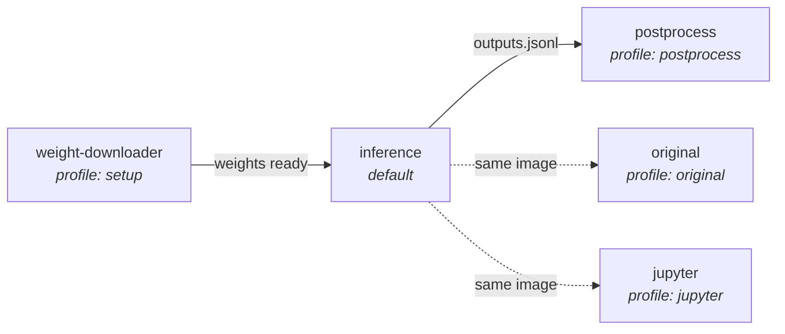

# CausalDriveBench Docker Operations

Reference for all Docker-related commands, services, and configuration.

---

## Prerequisites

### Docker Engine and NVIDIA runtime

```bash
# Docker Engine >= 24.x
docker --version

# NVIDIA Container Toolkit (GPU passthrough)
sudo apt-get install -y nvidia-container-toolkit nvidia-docker2
sudo systemctl restart docker

# Verify GPU access inside containers
docker run --rm --gpus all nvidia/cuda:12.1.0-base-ubuntu22.04 nvidia-smi
```

### Environment file

All `docker compose` commands read from `dev.env` in the model directory:

```bash
cp evaluation/models/<model>/dev.env.example \
   evaluation/models/<model>/dev.env
# Fill in: HF_TOKEN, WEIGHTS_DIR, RAW_DATA_DIR, CAUSAL_BENCH_DIR, OUTPUT_DIR
```

Run all commands from the model directory:

```bash
cd evaluation/models/<model>/
```

---

## The Five Services



| Service | Profile | Purpose |
|---------|---------|---------|
| `weight-downloader` | `setup` | Download model weights from HuggingFace (one-shot) |
| `original` | `original` | Run vendor's sample inference script (sanity check) |
| `inference` | *(default)* | Run benchmark evaluation pipeline |
| `postprocess` | `postprocess` | Parse outputs, compute accuracy metrics |
| `jupyter` | `jupyter` | Jupyter notebook for interactive development |

---

## Common Workflows

### Initial setup

```bash
# 1. Build the image
docker compose build

# 2. Download weights (~once per model)
docker compose --profile setup run --rm weight-downloader
```

### Benchmark evaluation

```bash
# Quick test — single scene
MODE=single SCENE=nuscenes-scene-0001 docker compose run --rm inference

# Small subset
MODE=subset SUBSET_SIZE=10 docker compose run --rm inference

# Full dataset
docker compose run --rm inference
```

### Post-processing

```bash
# Matches the mode/subset/scene used for inference
MODE=single SCENE=nuscenes-scene-0001 \
docker compose --profile postprocess run --rm postprocess
```

### Sanity check (model's own script)

```bash
docker compose --profile original run --rm original
```

### Interactive development

```bash
# Start Jupyter
docker compose --profile jupyter up jupyter
# Open: http://localhost:8888

# Or drop into a shell
docker compose run --rm --entrypoint bash inference
```

---

## Build Options

Force a clean rebuild (no layer cache):

```bash
docker compose build --no-cache
```

Pass build args to override defaults:

```bash
PYTHON_VERSION=3.11 docker compose build
```

---

## GPU Configuration

### All GPUs (default)

```yaml
deploy:
  resources:
    reservations:
      devices:
        - driver: nvidia
          count: all
          capabilities: [gpu]
```

### Specific GPU count

```yaml
devices:
  - driver: nvidia
    count: 2
    capabilities: [gpu]
```

### Specific GPU IDs

```yaml
devices:
  - driver: nvidia
    device_ids: ["0", "1"]
    capabilities: [gpu]
```

### Multi-GPU with accelerate

In `dev.env`:

```bash
CUDA_VISIBLE_DEVICES=0,1
```

In `inference.py`:

```python
self.model = AutoModel.from_pretrained(
    weights_path,
    device_map="auto",
    torch_dtype=torch.bfloat16,
)
```

---

## Logs

```bash
# Live logs from a running service
docker compose logs -f inference

# Logs from last run
docker compose logs inference
```

---

## Troubleshooting

### "CUDA out of memory"

- Reduce `BATCH_SIZE=1` in `dev.env`.
- Use `torch_dtype=torch.bfloat16` when loading the model.
- Add `torch.cuda.empty_cache()` between batches in `run_single`.

### "Could not select device driver"

```bash
sudo apt-get install -y nvidia-container-toolkit
sudo systemctl restart docker
```

### "No module named 'evaluation'"

The `Dockerfile` must set `PYTHONPATH` to include the repo root, or the script must add it via `sys.path`. The template uses:

```dockerfile
COPY evaluation/ /workspace/repo/evaluation/
```

And scripts add:
```python
sys.path.insert(0, str(Path(__file__).resolve().parents[3]))
```

### Container exits immediately

Run interactively to see the error:

```bash
docker compose run --rm --entrypoint bash inference
# Inside:
python inference.py --mode single --scene nuscenes-scene-0001
```

### Resume after partial run

`ModelInference.run_from_jsonl()` automatically skips `(sample_id, question_id)` pairs already written to `outputs.jsonl`. Re-run the same command to resume.

---

## Weight Download Patterns

### HuggingFace Hub (via docker compose)

```bash
docker compose --profile setup run --rm weight-downloader
```

### HuggingFace Hub (manual)

```bash
docker compose run --rm --entrypoint "" inference \
    huggingface-cli download "$MODEL_REPO" --local-dir /workspace/weights
```

### Direct URL

```bash
docker compose run --rm --entrypoint "" inference \
    wget -q --show-progress -O /workspace/weights/model.bin \
        https://example.com/model.bin
```

### AWS S3

```bash
docker compose run --rm --entrypoint "" inference \
    aws s3 cp s3://my-bucket/weights/ /workspace/weights/ --recursive
```