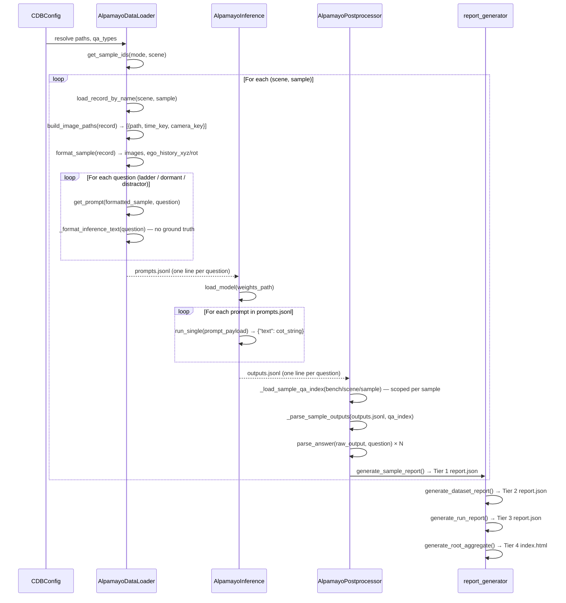
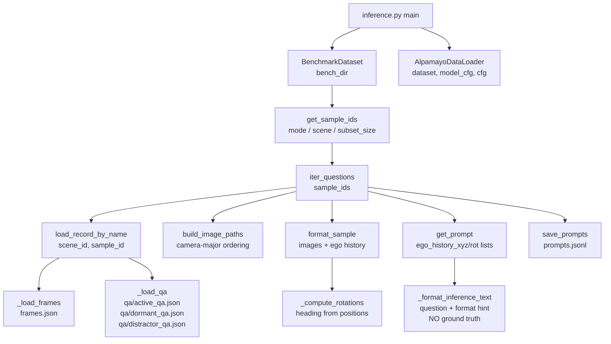
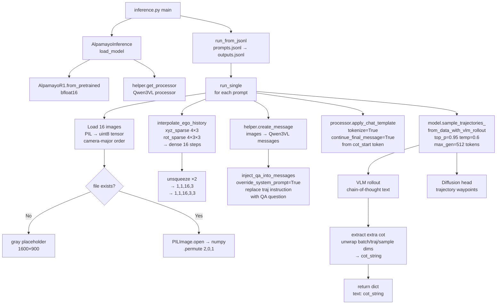
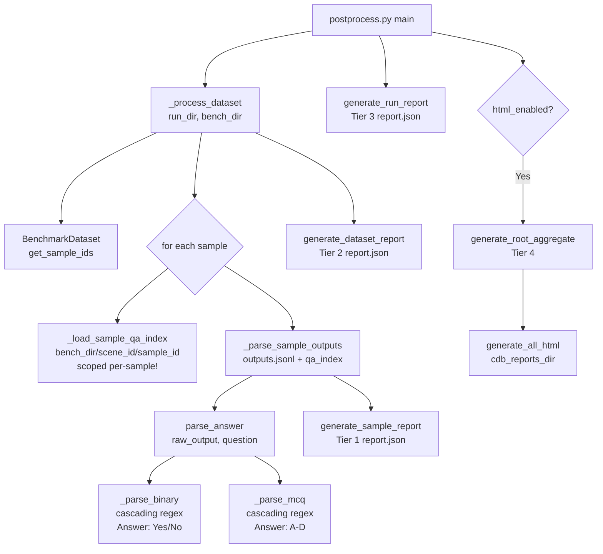
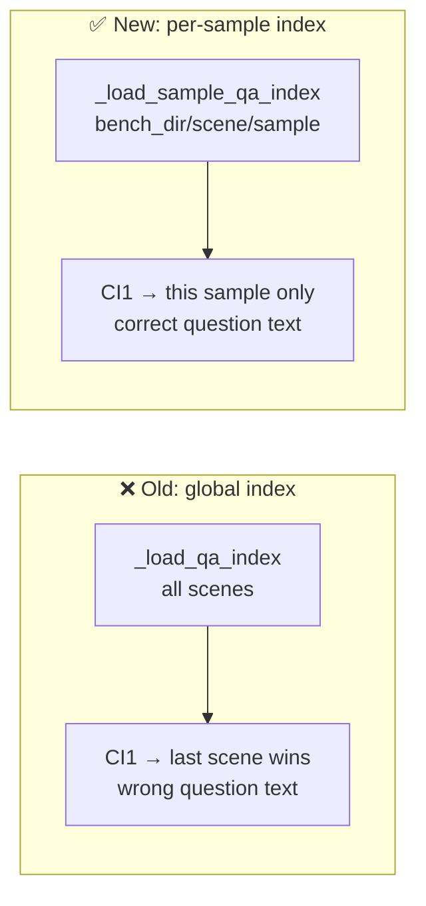
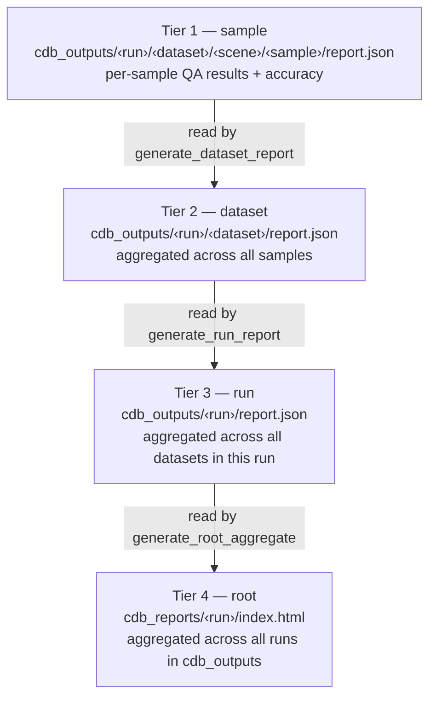

# CausalDriveBench Model Evaluation Pipeline

End-to-end walkthrough of how inference and metrics are computed.

---

## Pipeline Overview



---

## Stage 1: Data Loading

### Call Graph



`BenchmarkDataset` discovers sample directories and provides `load_record_by_name()`:

```python
dataset = BenchmarkDataset(bench_dir="/causal_drive_bench/causal_nuscenes")
sample_ids = dataset.get_sample_ids(mode="subset", subset_size=10)
# [{"scene_id": "nuscenes-scene-0159", "sample_id": "SAMPLED_0", "sample_idx": 0}, ...]
```

`AlpamayoDataLoader` converts raw records to model-specific prompt payloads via three abstract methods:

```python
loader = AlpamayoDataLoader(dataset=dataset, model_cfg={...}, cfg=cfg)

# Per sample — loads PIL images and ego history
record = dataset.load_record_by_name(scene_id, sample_id)
formatted = loader.format_sample(record)
# Returns: {scene_id, sample_id, images: 16 PIL.Images (camera-major), ego_history_xyz (4,3), ego_history_rot (4,3,3)}

# Per sample — resolves image paths in camera-major order
image_paths = loader.build_image_paths(record)
# Returns: [{"path": "...", "time_key": "Tm1p5", "camera_key": "cam_front"}, ...]

# Per question — builds JSON-safe model-specific fields only
prompt_extras = loader.get_prompt(formatted, question)
# Returns: {"ego_history_xyz": [[...], ...], "ego_history_rot": [[[...], ...], ...]}
```

`iter_questions()` merges framework fields with model-specific fields into a complete prompt record and writes `prompts.jsonl`. Framework fields injected automatically:

| Field | Source |
|-------|--------|
| `scene_id` | `record["scene_id"]` |
| `sample_id` | `record["sample_id"]` |
| `question_id` | `question["id"]` |
| `prompt_id` | auto-generated padded int |
| `is_evaluated` | `False` |
| `question_json_file` | e.g. `"dormant_qa.json"` |
| `answer_format` | `question["answer_format"]` |
| `question_text` | question + options, no answer |
| `qa_text` | question + format hint only — **no ground truth answer** |
| `image_paths` | list of `{path, time_key, camera_key}` dicts from `build_image_paths()` |

> **Note**: `qa_text` deliberately omits the correct answer and reasoning to prevent
> ground-truth leakage into the model prompt. It is generated by
> `_format_inference_text()`, not `format_qa_text()`. The format hint
> (`"Answer: Yes or No"` / `"Answer: A, B, C, or D"`) is included; the system
> prompt (`system_prompt.txt`) provides full output format instructions.

**Image ordering — camera-major** (matches Alpamayo training format):

```
Index  time_key  camera_key
  0    Tm1p5     cam_front
  1    Tm1p0     cam_front
  2    Tm0p5     cam_front
  3    Tp0p0     cam_front
  4    Tm1p5     cam_front_left
  ...
 15    Tp0p0     cam_back
```

**Ego history** is stored sparse (4 NuScenes timesteps at −1.5, −1.0, −0.5, 0.0 s) in
`prompts.jsonl`. Inference interpolates these to 16 dense steps using
`interpolate_ego_history()`.

**Record schema** (`BenchmarkDataset.load_record_by_name()`):

```python
{
  "scene_id":  "nuscenes-scene-0159",
  "sample_id": "SAMPLED_0",
  "state":     {...},   # state.json (ego + agents at T=0)
  "frames": {
    "Tm1p5": {"cam_front": "raw_data/.../file.jpg", "cam_front_left": "...", ...},
    "Tm1p0": {...},
    "Tm0p5": {...},
    "Tp0p0": {...},
  },
  "qa": {
    "ladder":     [...],   # from active_qa.json
    "dormant":    [...],   # from dormant_qa.json
    "distractor": [...],   # from distractor_qa.json
  },
}
```

**QA file → internal type mapping**:

| File | Internal `qa_type` key | `eval_config.yaml` name |
|------|------------------------|-------------------------|
| `active_qa.json` | `ladder` | `ladder` |
| `dormant_qa.json` | `dormant` | `dormant` |
| `distractor_qa.json` | `distractor` | `distractor` |

> **Important**: `eval_config.yaml` must use `ladder` (not `active`) in the
> `qa_types` list for active causal-ladder questions to be included.

---

## Stage 2: Inference (Alpamayo 1.0)

### Call Graph



### Message Structure

After `inject_qa_into_messages(override_system_prompt=True)`, the Qwen3VL message list is:

```
[System]    → system_prompt.txt (replaces alpamayo default)
[User]      → [16 image tokens]
              <|traj_history_start|><|traj_history|>×48<|traj_history_end|>

              Question: <question text>
              [A) ... B) ... C) ... D) ...]   ← MCQ only
              Format: Answer: Yes or No        ← or "A, B, C, or D"
[Assistant] → <|cot_start|>                  ← model continues from here
```

The driving instruction `"output the chain-of-thought reasoning of the driving
process, then output the future trajectory."` is **replaced** (not appended) by the
QA question so the model has a single, unambiguous instruction.

### `run_from_jsonl()` loop

```python
inference = AlpamayoInference(model_cfg=model_cfg, device="cuda", cfg=cfg)
inference.load_model(weights_path)
n_written = inference.run_from_jsonl(
    input_path=prompts_file,
    output_path=outputs_file,
    batch_size=1,
    resume=True,       # skips question_ids already in outputs.jsonl
)
```

**`run_single()` contract** — must return a dict with at least a `"text"` key:
```python
def run_single(self, prompt_payload: dict) -> dict:
    ...
    return {"text": cot_string}   # cot = chain-of-causation reasoning
```

**`image_paths` lookup pattern**:
```python
path_lookup = {
    (item["time_key"], item["camera_key"]): item["path"]
    for item in prompt_payload["image_paths"]
}
# e.g. ("Tm1p5", "cam_front") → "raw_data/.../file.jpg"
```

**Timestamped output structure**:
```
<dir_cdb_outputs>/<MODEL_ID>_<YYYYMMDD_HHMMSS>/   ← run_dir
├── inference.log
└── causal_nuscenes/
    └── <scene_id>/
        └── <sample_id>/
            ├── prompts.jsonl
            └── outputs.jsonl
```

**GPU-lazy loading**: `_has_pending_work()` checks all sample output files before
loading the model — avoids GPU allocation when everything is already processed.

**Resumption**: `question_id` entries already present in `outputs.jsonl` are skipped.
Safe to Ctrl-C and resume with `--run-dir <existing_run>`.

---

## Stage 3: Post-processing

### Call Graph



### Per-sample QA Index Scoping

Question IDs (`CI1`, `NI1`, `WC1`, …) are **reused across every scene** in the
benchmark. The global `_load_qa_index(bench_dir)` approach — which rglobs all
49+ scenes at once — causes the last alphabetical scene's question to overwrite
all others, producing wrong question texts in reports.



`_load_sample_qa_index(sample_bench_dir)` reads only the `qa/` subfolder of the
specific sample being evaluated, eliminating cross-scene ID collisions.

### Answer Extraction

`AlpamayoPostprocessor.parse_answer()` searches the model's chain-of-causation text
with cascading regex patterns:

**Binary (Yes/No)**:
1. `Answer:\s*(Yes|No)` — highest priority
2. `answer\s+is\s+(Yes|No)`
3. `^(Yes|No)[.,\s]` — line-start
4. `\b(Yes|No)\b` — fallback

**MCQ (A–D)**:
1. `Answer:\s*([A-D])`
2. `answer\s+is\s+([A-D])`
3. `Option\s+([A-D])`
4. `([A-D])[).]\s`
5. `^\s*([A-D])\s*$`
6. `\b([A-D])\b` — fallback

The model's output may optionally be wrapped in `<think>...</think>` tags (reasoning
model style). Both the inner content and the full text are searched in order.

### Report Tiers



Tier 1 reports are **incremental**: skipped if their stored `schema_version` matches
`eval_config.yaml`. Bump `reporting.schema_version` to force full regeneration.

Tiers 2–4 always regenerate (fast: only read pre-computed JSON).

```python
postprocessor = AlpamayoPostprocessor(model_cfg={})
# Tier 1 + 2 generated by _process_dataset():
_process_dataset(run_dir, "causal_nuscenes", bench_dir, postprocessor, ...)

# Tier 3:
generate_run_report(run_name, run_dir, run_dir / "report.json", ...)

# Tier 4 + HTML:
root = generate_root_aggregate(cfg.dir_cdb_outputs, schema_version)
generate_all_html(run_name, cfg.dir_cdb_outputs, cfg.dir_cdb_reports, root)
```

**`raw_output` format** — `_extract_text()` handles both schemas:
```python
raw_output = {"text": "Answer: No\nReasoning: ..."}  # new dict format
raw_output = "Answer: No\nReasoning: ..."             # legacy plain string
```

---

## Evaluation Modes

| Mode | `--mode` | Description |
|------|----------|-------------|
| Full | `full` | All scenes in the benchmark |
| Subset | `subset --subset-size N` | N randomly sampled scenes |
| Single | `single --scene <name>` | Exactly one scene (fastest, for debugging) |

Pass identical mode flags to both `inference.py` and `postprocess.py` so they
operate on the same set of samples.

---

## LLM Judge (Optional)

For reasoning evaluation beyond exact-match accuracy. Scores each model response on
four dimensions:

| Dimension | Description | Score |
|-----------|-------------|-------|
| `spatial_grounding` | Correctly identifies locations and positions of agents | 0–2 |
| `mechanism_identification` | Explains the causal mechanism driving the event | 0–2 |
| `conditionality_awareness` | Understands conditional/hypothetical nature | 0–2 |
| `answer_consistency` | Final answer matches the reasoning given | 0–2 |

**Composite score** = mean of all four dimensions (0–2 scale).

```python
metrics = postprocessor.compute_metrics(
    outputs_path="outputs.jsonl",
    bench_dir="...",
    use_llm_judge=True,
    judge_cfg={
        "provider": "anthropic",          # "anthropic" | "openai" | "azure_foundry"
        "model": "claude-opus-4-6",
        "api_key_env": "ANTHROPIC_API_KEY",
    },
)
```

Three supported judge backends:

| Provider | `provider` value | Notes |
|----------|-----------------|-------|
| Anthropic | `"anthropic"` | Recommended; uses `claude-opus-4-6` |
| OpenAI | `"openai"` | Uses `gpt-4o` or similar |
| Azure AI Foundry | `"azure_foundry"` | Azure-hosted Claude or OpenAI models |

Configure in `eval_config.yaml` under `evaluation.judge`:

```yaml
evaluation:
  use_llm_judge: false   # set true to enable
  judge:
    provider: anthropic
    model: claude-opus-4-6
    api_key_env: ANTHROPIC_API_KEY
```

---

## Orchestrator (Multi-model)

The top-level `orchestrate.py` runs the full pipeline for one or more models:

```bash
# Single model, single-scene debug
python evaluation/orchestrate.py \
    --model alpamayo_1_0 \
    --mode single --scene nuscenes-scene-0159

# Subset run
python evaluation/orchestrate.py \
    --model alpamayo_1_0 \
    --dataset causal_nuscenes \
    --mode subset --subset-size 50

# Multiple models, full benchmark
python evaluation/orchestrate.py \
    --models alpamayo_1_0,drivelm \
    --mode full

# Dry run (print commands only)
python evaluation/orchestrate.py --model alpamayo_1_0 --dry-run
```

The orchestrator reads `eval_config.yaml` for model registry, dataset paths, and
`qa_types`. Only models with `enabled: true` are run.

---

## Metrics

| Metric | Description |
|--------|-------------|
| `overall.accuracy` | Exact-match accuracy across all questions |
| `overall.n` | Total number of questions evaluated |
| `per_qa_type.ladder` | Accuracy for active causal-ladder questions (MCQ) |
| `per_qa_type.dormant` | Accuracy for dormant link questions (binary) |
| `per_qa_type.distractor` | Accuracy for distractor node questions (binary) |
| `confusion` | Confusion matrix and most-confused pairs |
| `reasoning_score` *(optional)* | LLM judge composite and per-dimension scores (0–2) |

All metrics are computed by pure-Python functions in `common/metrics.py` with no
GPU dependencies.
