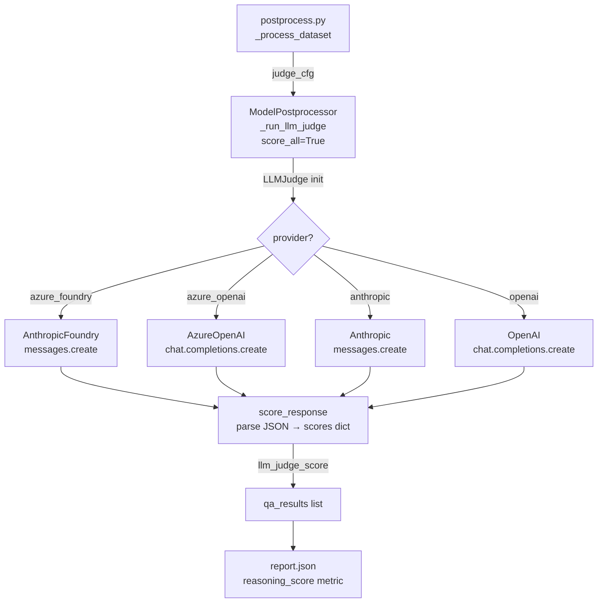

# LLM Judge

The LLM judge scores chain-of-causation (CoC) reasoning quality in model responses using a four-dimension rubric. It is an optional layer on top of binary/MCQ accuracy — useful when you want to understand *why* a model got an answer right or wrong.

---

## Rubric

Each response is scored on four dimensions, each 0–2:

| Dimension | 0 — Absent | 1 — Partial | 2 — Complete |
|---|---|---|---|
| **spatial_grounding** | No spatial references | Imprecise or incomplete | All key objects correctly placed relative to ego |
| **mechanism_identification** | No causal mechanism stated | Mechanism implied but not articulated | Cause → effect chain explicitly correct |
| **conditionality_awareness** | No mention of conditions | Conditions partially acknowledged | Active / dormant / distractor conditions precisely stated |
| **answer_consistency** | Answer contradicts reasoning | Minor inconsistency | Reasoning and final answer fully consistent |

**Composite score** = mean of all four dimensions (range 0–2).

The rubric is defined in [`evaluation/common/prompts/llm_judge_system.txt`](../common/prompts/llm_judge_system.txt). Edit that file to change scoring criteria without touching Python code.

---

## Providers

Four API providers are supported:

| Provider key | Client (SDK) | Recommended judge model | Required env vars |
|---|---|---|---|
| `anthropic` | `anthropic.Anthropic` | `claude-opus-4-6` | `ANTHROPIC_API_KEY` |
| `openai` | `openai.OpenAI` | `gpt-4o` | `OPENAI_API_KEY` |
| `azure_foundry` | `anthropic.AnthropicFoundry` | `claude-opus-4-6` | `ANTHROPIC_FOUNDRY_API_KEY`, `FOUNDRY_BASE_URL` |
| `azure_openai` | `openai.AzureOpenAI` | deployment name | `AZURE_OPENAI_API_KEY`, `AZURE_OPENAI_ENDPOINT` |

### Azure AI Foundry — Claude (`azure_foundry`)

Runs Claude models deployed through Microsoft Azure AI Foundry. Uses the `AnthropicFoundry` client from the Anthropic SDK.

**Install:**
```bash
pip install "anthropic>=0.40"
```

**Required environment variables:**
```bash
export ANTHROPIC_FOUNDRY_API_KEY="<your-azure-api-key>"
export FOUNDRY_BASE_URL="https://<resource-name>.services.ai.azure.com/anthropic"
```

The `FOUNDRY_BASE_URL` is the endpoint shown in your Azure AI Foundry resource under **Keys and Endpoint**. The `/anthropic` suffix is required.

**Python usage:**
```python
from evaluation.common.llm_judge import LLMJudge

judge = LLMJudge(provider="azure_foundry", model="claude-opus-4-6")
result = judge.score_response(
    question="Is the pedestrian responsible for the ego vehicle braking?",
    ground_truth="Yes",
    model_response="The pedestrian stepped onto the crosswalk directly in the ego's path, forcing a brake.",
)
print(result["composite_score"])   # 0.0 – 2.0
print(result["scores"])            # {"spatial_grounding": 2, ...}
```

### Azure OpenAI Service — GPT (`azure_openai`)

Runs GPT models deployed through Azure OpenAI Service. Uses the `AzureOpenAI` client from the OpenAI SDK.

**Install:**
```bash
pip install openai
```

**Required environment variables:**
```bash
export AZURE_OPENAI_API_KEY="<your-azure-openai-api-key>"
export AZURE_OPENAI_ENDPOINT="https://<resource-name>.openai.azure.com/"
```

**Python usage:**
```python
from evaluation.common.llm_judge import LLMJudge

judge = LLMJudge(
    provider="azure_openai",
    model="gpt-4o",              # Azure deployment name
    azure_api_version="2024-12-01-preview",
)
result = judge.score_response(
    question="...",
    ground_truth="No",
    model_response="...",
)
```

---

## Configuration (`eval_config.yaml`)

Enable and configure the judge under `evaluation.judge`:

```yaml
evaluation:
  use_llm_judge: true

  judge:
    provider: azure_foundry           # or: anthropic, openai, azure_openai
    model: claude-opus-4-6            # deployment/model name
    api_key_env: ANTHROPIC_FOUNDRY_API_KEY
    azure_endpoint_env: FOUNDRY_BASE_URL
    azure_api_version: "2024-12-01-preview"   # only for azure_openai
```

All `api_key_env`, `azure_endpoint_env`, and `azure_api_version` keys are optional — they fall back to per-provider defaults in `LLMJudge` if omitted.

---

## Running Postprocess with the Judge

```bash
# Inside Docker container
python postprocess.py \
  --run-dir /workspace/data/cdb_outputs/alpamayo_1_0_20260410_120000 \
  --use-llm-judge \
  --judge-provider azure_foundry \
  --judge-model claude-opus-4-6

# On host
source /datadrive/envs/alpamayo/bin/activate
python evaluation/models/alpamayo_1_0/postprocess.py \
  --run-dir /datadrive/datasets/cdb_outputs_20260409/alpamayo_1_0_20260417_190704 \
  --use-llm-judge \
  --judge-provider azure_foundry
```

The `--judge-provider` and `--judge-model` CLI flags override `eval_config.yaml`.

---

## How Judge Scores Appear in Reports

When the judge runs, each `qa_result` entry in `report.json` gains an `llm_judge_score` field:

```json
{
  "question_id": "CI1",
  "qa_type": "distractor",
  "predicted": "No",
  "ground_truth": "No",
  "correct": true,
  "raw_output_text": "The van is in an adjacent lane and not blocking our path...",
  "llm_judge_score": {
    "scores": {
      "spatial_grounding": 2,
      "mechanism_identification": 1,
      "conditionality_awareness": 2,
      "answer_consistency": 2
    },
    "composite_score": 1.75,
    "reasoning": "Spatial references are correct. The mechanism of non-interference is implied but not fully articulated. Conditions are precisely stated. Answer is consistent."
  }
}
```

At the dataset level, if `reasoning_score` is included in `reporting.metrics`, aggregate statistics appear under `metrics.reasoning_score`:

```yaml
reporting:
  metrics:
    - overall
    - per_qa_type
    - confusion
    - reasoning_score   # add this to enable aggregate judge stats
```

---

## Prompt Customisation

The judge prompts live in `evaluation/common/prompts/`:

| File | Purpose |
|---|---|
| `llm_judge_system.txt` | System prompt with rubric definitions and output format |
| `llm_judge_user_template.txt` | User turn template: question, ground truth, model response |

Edit these files directly. They are loaded at import time — no code changes needed. The `{question}`, `{ground_truth}`, `{model_response}`, and `{criteria_section}` placeholders in the user template are populated by `LLMJudge.score_response()`.

---

## Call Graph



---

## Bugs Fixed

| Bug | Symptom | Fix |
|---|---|---|
| `azure_foundry` used `AzureOpenAI` (wrong for Claude) | Claude API calls routed through Azure OpenAI endpoint, resulting in auth errors | Changed to `AnthropicFoundry` from `anthropic` SDK |
| `_run_llm_judge` filtered out all CDB question types | Judge never ran; `reasoning_score` always empty | Added `score_all=True` parameter; `_process_dataset` passes it explicitly |
| Field name mismatch `question` vs `question_text` | Judge received empty question string | `_run_llm_judge` now tries both keys with fallback |
| `_build_judge_cfg` didn't pass `azure_endpoint_env` | `LLMJudge` could not find the endpoint env var | Now extracted from `eval_config.yaml` judge block and passed through |
